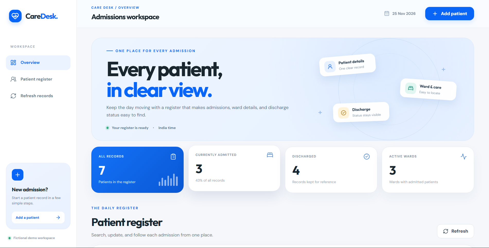
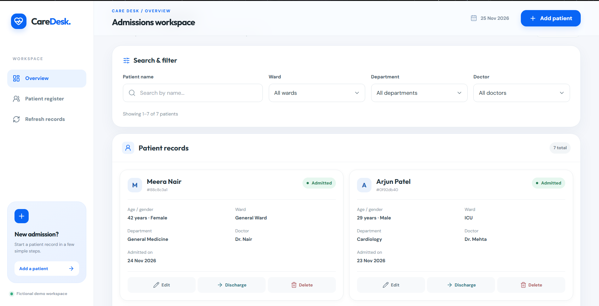
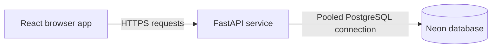

# Care Desk

**An admissions register with room to breathe.**

Care Desk gives hospital staff one clear place to record admissions, find a patient, update their ward or doctor, and mark a discharge. The interface is built for a busy desk: a quick overview, direct search and filters, and patient cards on smaller screens.

`React + TypeScript` · `FastAPI + Python` · `Neon PostgreSQL` · `Render ready`

**Repository:** [anshuS1310/Care_Desk](https://github.com/anshuS1310/Care_Desk)

**Live app:** _Pending Render deployment. Add the Static Site URL here after the final live check._

> [!IMPORTANT]
> This is a fictional-data demo. The brief does not require login, so a public deployment has no access control. Anyone with its URL can view or change records. **Never enter real patient information.**

## A look inside

### The overview



Live totals show records, admitted patients, discharges, and active wards. The navigation rail leads straight to the register.

### The patient register



Search by name, combine ward, department, and doctor filters, then edit, discharge, or delete from a patient card. A wide desktop shows a table; phone and tablet layouts use cards.

## What it does

| Work at the desk | Care Desk behavior |
| --- | --- |
| Add a patient | Saves the seven editable fields and starts status at **Admitted**. |
| View patients | Shows all records across numbered pages, 100 per page, with a visible total. |
| Find someone | Case-insensitive name search and combinable ward, department, and doctor filters. |
| Correct a record | Opens a prefilled form; status remains read-only. |
| Discharge | Confirms the action, changes status, and retains the record. |
| Delete | Requires confirmation before removing the record. |

Both the browser and API validate names, strict integer ages from 0 to 120, fixed dropdown choices, and admission dates no later than today in **Asia/Kolkata**. The API returns plain messages beside the affected fields. The UI handles loading, empty results, stale edits, and uncertain saves.

## How it is built

| Layer | Technology | Job |
| --- | --- | --- |
| Interface | React 19, TypeScript, Vite, CSS | Responsive workspace, forms, filters, and patient actions. Node is used only to build the frontend. |
| API | Python 3.13, FastAPI, Pydantic, SQLAlchemy, psycopg | Validates requests, applies patient rules, and queries PostgreSQL. The running backend is **not Node.js**. |
| Data | Neon PostgreSQL | Persists patient records across API restarts and redeploys. |
| Hosting | Render Web Service + Static Site | Separate Python API and built React site. No Render database is needed. |



## Run it on your computer

The Neon `production` branch is already linked for this project and its schema has been applied. A fresh clone needs its own private `.env.local` file because secrets are intentionally excluded from GitHub.

### 1. Get the code and tools

Install [Git](https://git-scm.com/downloads), [Node.js 24](https://nodejs.org/en/download), and [Python 3.13](https://www.python.org/downloads/) if they are missing. Then clone the repository:

```powershell
git clone https://github.com/anshuS1310/Care_Desk.git
cd Care_Desk
```

The project pins Node `24.16.0` in `frontend/.node-version` and Python `3.13.5` in `backend/.python-version`.

### 2. Restore the private Neon connection

From the project root in PowerShell:

```powershell
npm i -g neon@latest
neon login
neon init -y --org-id org-raspy-bread-61157099 --project-id young-scene-48114166 --branch production --services postgres
neon deploy
```

If global installation fails, use `npx neon@latest` in place of `neon`. Complete browser sign-in if the CLI opens it. `neon deploy` writes the pooled `DATABASE_URL` and direct `DATABASE_URL_UNPOOLED` into **`.env.local`**, which Git ignores. Never paste either URL into source code, a commit, or an issue.

### 3. Install and prepare the database

The schema command is safe to run again. It uses the direct Neon connection and checks that the table exists.

**Windows PowerShell, from the project root:**

```powershell
py -3.13 -m venv backend/.venv
backend/.venv/Scripts/python.exe -m pip install -r backend/requirements.txt
backend/.venv/Scripts/python.exe backend/scripts/apply_schema.py
npm ci --prefix frontend
```

**macOS or Linux:**

```bash
python3.13 -m venv backend/.venv
backend/.venv/bin/python -m pip install -r backend/requirements.txt
backend/.venv/bin/python backend/scripts/apply_schema.py
npm ci --prefix frontend
```

`psql` is optional. If it is installed and `DATABASE_URL_UNPOOLED` is set in your shell, the equivalent commands are `psql -X -v ON_ERROR_STOP=1 -f .\backend\schema.sql "$env:DATABASE_URL_UNPOOLED"` in PowerShell or `psql -X -v ON_ERROR_STOP=1 -f backend/schema.sql "$DATABASE_URL_UNPOOLED"` on macOS/Linux. Neon gives a `postgresql://` URL; the Python app converts it internally to SQLAlchemy's `postgresql+psycopg://` format.

### 4. Start two terminals

**Terminal 1 — API:**

```powershell
cd backend
.venv/Scripts/python.exe -m uvicorn app.main:app --host 127.0.0.1 --port 8000
```

**Terminal 2 — interface:**

```powershell
cd frontend
npm run dev
```

On macOS/Linux, use `.venv/bin/python` in Terminal 1. Open **http://localhost:5173**. The API health check is **http://localhost:8000/health** and its interactive docs are **http://localhost:8000/docs**. If port 8000 is already in use and `/health` says `{"status":"ok"}`, the API is already running; open the frontend instead of starting a second copy.

Optional fictional records can be restored with `backend/.venv/Scripts/python.exe backend/scripts/seed_demo.py` from the project root. The seed is safe to repeat.

## Deploy on Render, from the beginning

The order is **Neon schema → Python API → React site → CORS → live check**. The schema is already applied to this Neon branch, but repeat the schema command if you use another database.

### 1. Publish the repository

The public GitHub repository is [Care_Desk](https://github.com/anshuS1310/Care_Desk). Push `main` before using Render. Keep `.env.local`, `.env`, `.neon`, virtual environments, and `node_modules` out of commits.

### 2. Create the API service

1. Sign in at [Render Dashboard](https://dashboard.render.com/) and choose **New → Web Service**.
2. Connect GitHub if asked, then select `anshuS1310/Care_Desk` and branch `main`.
3. Set **Root Directory** to `backend` and **Runtime** to Python.
4. Set **Build Command** to `pip install -r requirements.txt`.
5. Set **Start Command** to `uvicorn app.main:app --host 0.0.0.0 --port $PORT`.
6. In **Environment**, add `PYTHON_VERSION=3.13.5`. Add `DATABASE_URL` using the **pooled** URL from your private root `.env.local` or Neon Dashboard. Paste it only into Render's private environment field. Leave `CORS_ORIGINS` unset for now.
7. Create/deploy the service. Copy its HTTPS URL. Open `<API_URL>/health`; it must return `{"status":"ok"}`. Also open `<API_URL>/api/patients` to confirm the schema is available. A first request may take longer while the service wakes.

### 3. Create the frontend site

1. In Render, choose **New → Static Site**, select the same repository and `main` branch.
2. Set **Root Directory** to `frontend`.
3. Set **Build Command** to `npm ci && npm run build` and **Publish Directory** to `dist`.
4. In **Environment**, add `NODE_VERSION=24.16.0` and `VITE_API_BASE_URL=<API_URL>` using the API's full HTTPS origin **without a trailing slash**. This value is compiled into the site, so set it **before** the build and rebuild if it changes.
5. Deploy and copy the Static Site's HTTPS URL.

### 4. Allow the site to call the API

Return to the Python Web Service's **Environment** page. Add `CORS_ORIGINS=<STATIC_SITE_URL>` using the exact origin, with no trailing slash or path. If you use multiple site origins, separate them with commas. Save and let the API redeploy.

### 5. Check the public app and add its link here

Open the Static Site on a phone and desktop. Using **fictional data**, add a patient, search and filter, edit, discharge, and delete with confirmation. Restart or redeploy the API and confirm a retained record is still present. Then replace the **Live app** line at the top of this README with the real Static Site URL and push that small README change.

## Verify and troubleshoot

```powershell
npm run build
npm --prefix frontend run test:names
cd backend
.venv/Scripts/python.exe -m pytest -q
```

The API tests create and clean up temporary fictional records in the configured Neon branch, including a 101-record paging check. The shared name fixtures verify the Python and JavaScript rules against the same Unicode examples.

| If you see… | Check… |
| --- | --- |
| `Address already in use` on port 8000 | Another API is running. Open `/health` or stop the old process before starting one more. |
| The site loads but records do not | API `/health`, the Static Site's `VITE_API_BASE_URL`, and the API's `CORS_ORIGINS`. Rebuild after changing the Vite variable. |
| API errors on every patient request | Run `backend/scripts/apply_schema.py` against the correct Neon branch. |
| A slow first request | Free services may wake after inactivity. The UI displays a connection message and gives writes up to 90 seconds. |

## Repository map

```text
backend/app/             FastAPI routes, models, validation, error responses
backend/schema.sql       Re-runnable PostgreSQL schema
backend/scripts/         Schema setup and fictional demo seed
frontend/src/            React workspace, form, dialogs, API client, CSS
shared/name-fixtures.json  Unicode name examples tested in both languages
docs/screenshots/        Real Care Desk screen captures
neon.ts                  Neon project policy
```

## Safety and known limits

- The public demo has no authentication or audit trail. It is **not suitable for real patient data**.
- Concurrent edits use last save wins.
- Doctor and department are independent choices.
- The strict letters-only name rule rejects zero-width characters, which some real names need.
- Deleting a record is permanent. Use only fictional data in the demo.

The project stores secrets only in local ignored environment files or Render's private environment settings. The GitHub repository contains examples, source code, and screenshots—no database password or API key.
